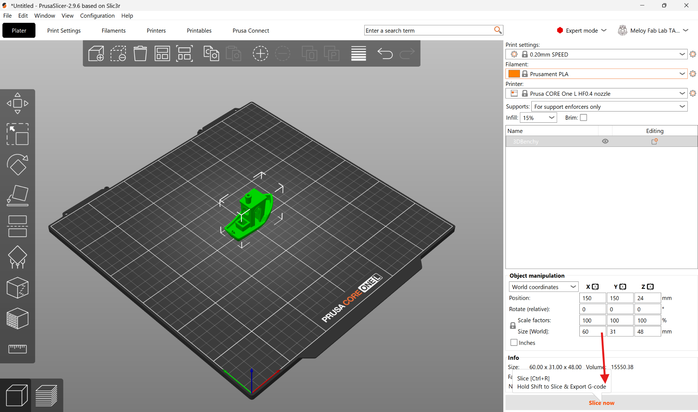
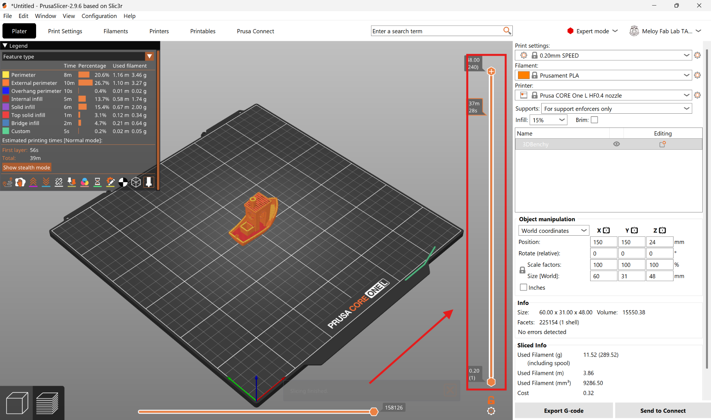

The Prusa Core One+ and Core One L build parts one thin layer at a time, melting plastic filament and drawing each layer onto a heated plate (fused deposition modeling, or FDM). They're the lab's workhorse for prototypes, brackets, enclosures, jigs, replacement parts, and anything else you'd rather hold than look at on a screen. Most parts come off in a few hours. The Fab Lab has eight of them: one large printer (**Clarkson**) and seven standard printers (**Lightning, Mater, Finn, Geoff, Hammond, Sally, and May**). Each print uses one color or material, and TPU is supported. Your part must fit inside a **250 × 220 × 270 mm** cube on a standard printer, or a **300 × 300 × 330 mm** cube on Clarkson. If you're not sure this is the right machine for your project, see [Which machine should I use?](/docs/which-machine/).

> [!WARNING]
> **The nozzle and heated bed get hot.** Never touch either while the printer is running or just after a print finishes, and never reach into the printer during a print.

:::caution[EMERGENCY STOP]
**[Describe how to stop a printer mid-print and how to cut its power, and who to notify.]**
:::

## Before you start

- Print only **staff-approved filaments**: **PLA** and **PETG**, plus **TPU** **[confirm the full approved list — ASA and PC Blend also appear in the slicer's filament menu]**. If you're not sure what a filament is or whether it's allowed, ask a staff member — don't guess.
- Your part must be a **STL or 3MF** file.
- You slice your model on the lab computer in **PrusaSlicer** before the printer can run it. The steps are below.
- Decide which printer you'll use: a standard printer if your part fits within 250 × 220 × 270 mm, or **Clarkson** if it needs up to 300 × 300 × 330 mm.

## Operating

### Prepare your model in PrusaSlicer

1. Open **PrusaSlicer** on the lab computer.
2. In the printer profile dropdown, select **Prusa CORE One** (for a standard printer) or **Prusa CORE One L** (for Clarkson, the large printer).

   

3. In the filament dropdown, choose your material (for example **PLA** or **PETG**), then pick a preset quality layer height — typically **0.20mm Structural** or **Speed**.

   

4. Click the **cube icon** at the top left of the toolbar, find your downloaded part file (STL or 3MF), and click **Open**. You can also drag and drop your file directly onto the build plate.

   

5. Use the manipulation tools on the **left toolbar** to scale and rotate your part. Use **Place on Face (F)** to lay a flat side of the part against the build plate. Hover over any tool icon to see its name and keyboard shortcut.

   

6. Add supports if your part needs them. Use the **Supports** dropdown in the right panel and choose **Support on build plate only** (supports start only from the plate) or **Everywhere** (supports can also start from the part itself). To have PrusaSlicer generate supports automatically, go to **Print Settings → Support Material** and check **Autogenerated supports**. You can also place supports by hand using the tool on the left toolbar. Not every part needs supports — ask a staff member if you're unsure.

### Slice and send

7. Click **Slice Now** in the bottom-right corner. This converts your model into printer instructions called G-code, which splits the part into layers the nozzle deposits one at a time.

   

8. Review the preview. Drag the **vertical layer slider** on the right side of the screen to inspect your layers, and check that nothing is floating without support. Confirm the material, infill density, and printer are what you intend.

   

9. Click **Send to Connect** in the bottom-right corner. In the window that opens, select the printer you want to print on, choose **Add to print queue**, and click **Confirm**.

   

10. **[Describe what happens at the printer next: whether the queued job starts on its own or has to be started from the printer's screen, and anything to check before it starts, like a clear bed or the right filament loaded.]**

### Remove your part

11. Wait for the heated bed to cool to **room temperature** so the part releases safely.

> [!WARNING]
> Don't try to pry a part off a hot bed. The bed stays hot for several minutes after a print finishes — touch it only after it has cooled.

12. Lift the flexible **PEI spring steel sheet** off the magnetic bed, bend it gently, and your print will pop right off.
13. Put the sheet back on the magnetic bed, lining it up with the **two locating pins at the back** of the printer.

## Finishing up

- Remove all of your parts, supports, and scrap from the printer.
- Confirm the steel sheet is seated on the bed against both locating pins for the next user.
- Take your project and any leftover material with you — the lab has no storage.
