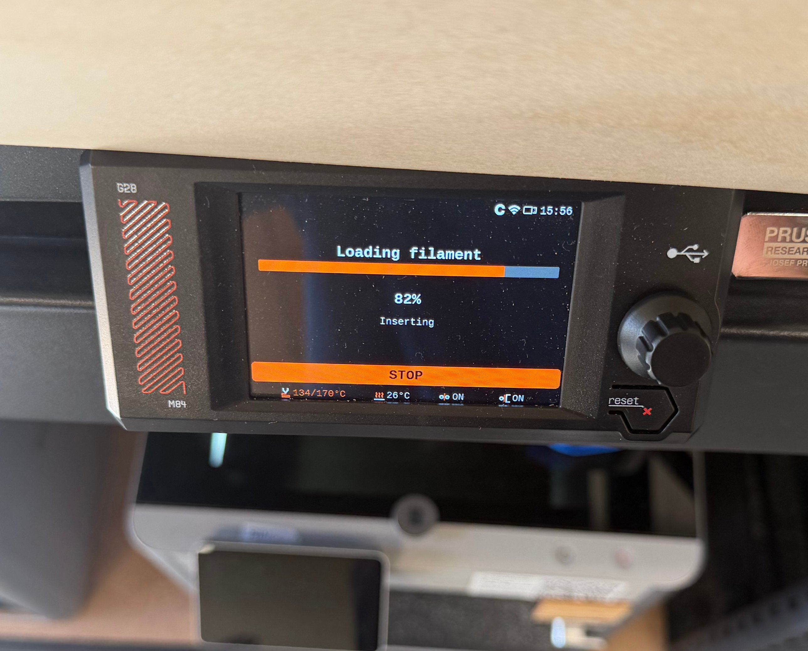
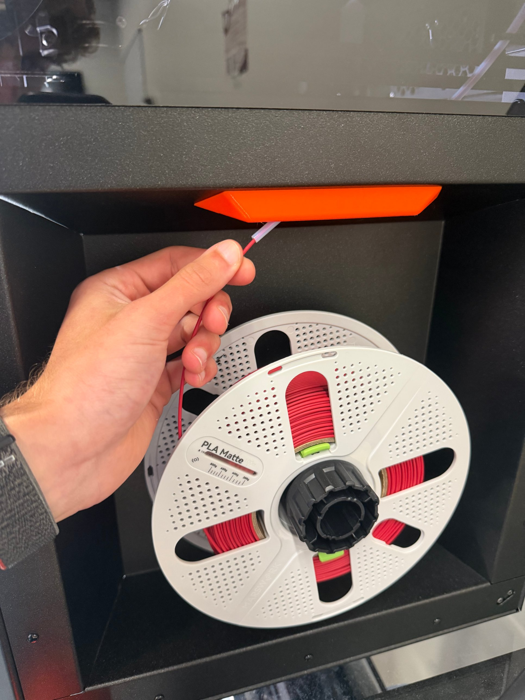
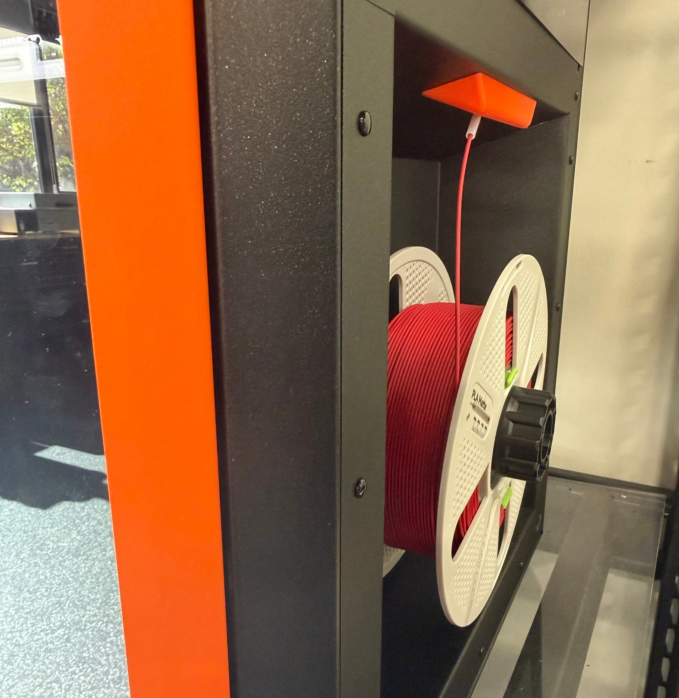
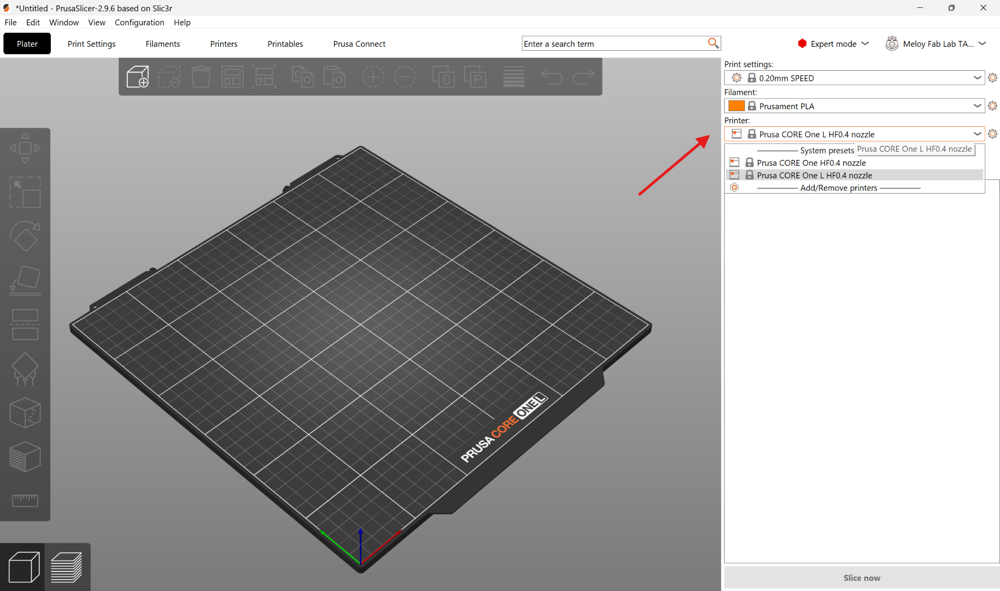
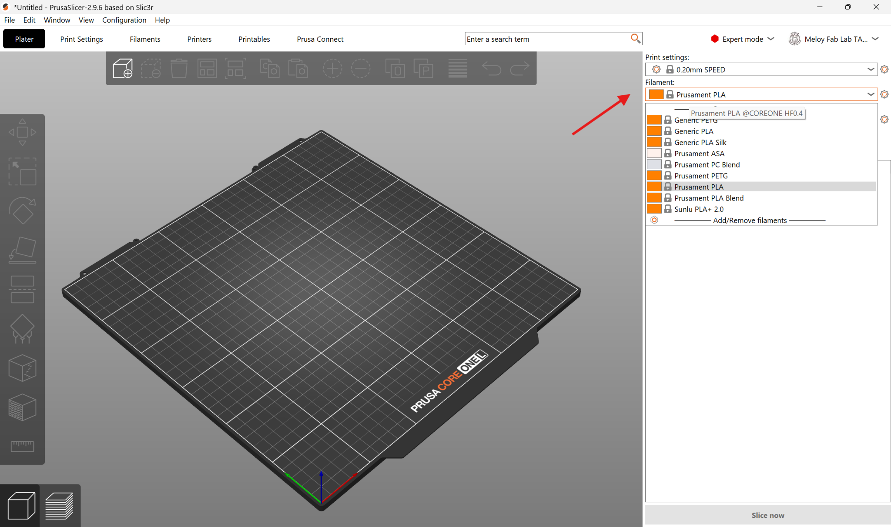
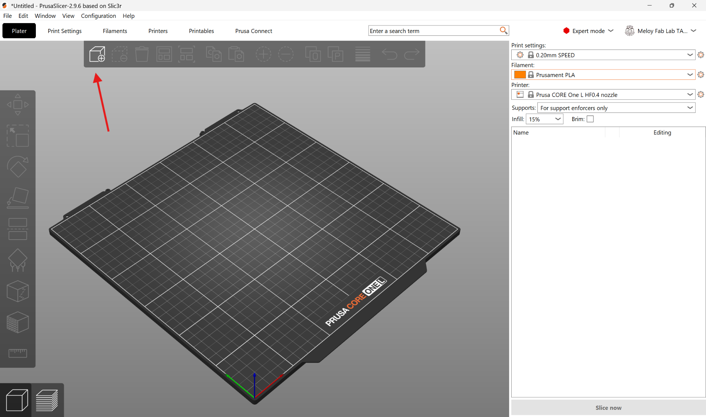
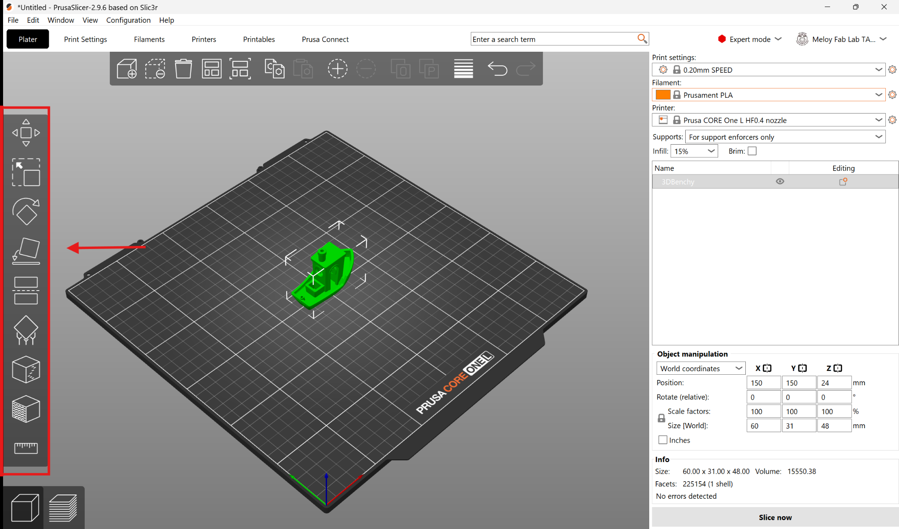
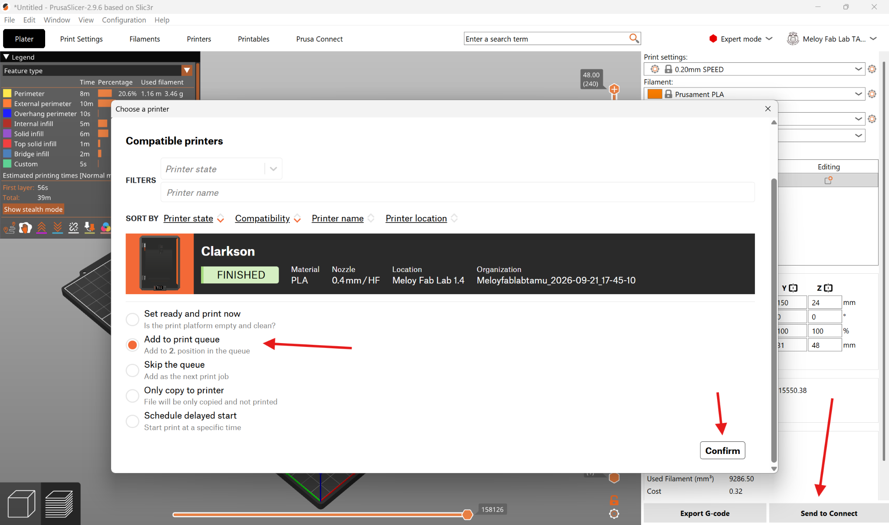

The **Prusa Core One+** and **Prusa Core One L+** build parts one thin layer at a time, melting plastic filament and drawing each layer onto a heated plate (fused deposition modeling, or FDM). They're the lab's workhorse for prototypes, brackets, enclosures, jigs, replacement parts, and anything else you'd rather hold than look at on a screen. Most parts come off in a few hours. The Fab Lab has eight of them: one large printer (**Clarkson**) and seven standard printers (**Lightning, Mater, Finn, Geoff, Hammond, Sally, and May**). Each print uses one color or material, and TPU is supported. Your part must fit inside a **250 × 220 × 270 mm** cube on a standard printer, or a **300 × 300 × 330 mm** cube on Clarkson. If you're not sure this is the right machine for your project, see [Which machine should I use?](/docs/which-machine/).

> [!WARNING]
> **The nozzle and the build plate get hot enough to burn you.** The nozzle runs up to 300 °C and the plate up to 100 °C, and both stay dangerous for several minutes after a print ends. Never reach into the chamber to touch the toolhead or the plate.

> [!WARNING]
> **Keep the chamber door and the glass lid closed while a print is running.** The toolhead moves fast, without warning, and won't stop for your hand. If you need to get inside, stop the print first.

:::caution[EMERGENCY STOP]
Tap **Stop** on the printer's touchscreen — that cancels the print and parks the toolhead. To cut power completely, flip the **power switch on the back of the machine**, next to where the power cable plugs in. Tell a staff member either way.
:::

:::caution[SMOKE OR BURNING SMELL]
Stop the print, cut power at the rear switch, and get a staff member immediately. **Keep the chamber closed** — the enclosure contains the problem, and opening it feeds it air. Warm plastic has a mild smell; smoke, an acrid burning smell, or scorching does not belong and is never something to wait out.
:::

> [!NOTE]
> **No PPE is needed for this machine.** No goggles, no gloves, no mask. Tie back long hair and keep loose sleeves and drawstrings clear of the chamber when it's open, and you're set.

## Before you start

- **No training or checkout is required.** Read this page, then go print. If it's your first time, staff are happy to stand with you — just ask.
- Bring a **3D model file**: `.stl`, `.obj`, `.3mf`, or `.step`. PrusaSlicer opens all of them.
- **To get your file onto a lab computer**, email it to **usertamufablab@gmail.com**, then open Gmail on a lab computer and download it there. A USB drive works too.
- **Approved filaments:**
  - **PLA** and **PETG** — go ahead, no questions asked.
  - **TPU** (the flexible one) — allowed, but ask a staff member to set it up.
  - **ABS** and **ASA** — check with a staff member first.
  - **Nylon**, and any **carbon-fiber- or glass-filled** filament — not approved on these machines.
- **Lab filament is free** — the lab is stocked with PLA filament already, and you are welcome to move rolls around on machines. Follow the guide below on how to unload and load filament.
- **Keep the door closed while printing.** With it shut, the chamber's activated-carbon filter handles what little the plastic gives off, and drafts in the room that may harm print quality are mitigated. (It's also why ABS and ASA need a staff OK — those are the ones that actually smell.)
- **Don't touch the top surface of the build plate.** Skin oil is the single most common reason a print won't stick. Pick the plate up by its edges or the tab at the front.
- **Removing Others' Prints:** If all printers are occupied and some prints are complete, you (or a staff member) can carefully remove the prints of others.

## Loading Filament

1. Locate the **Material** and **Color** of filament you would like to use. Ensure the spool is not tangled and clip the end of the filament to a perpendicular or slightly angled end.
2. Determine whether filament is already loaded into the machine:
   - If **YES**, go to **Filament**, **Unload**, and select **Type of Filament**. The filament will be heated and cut from the end of the nozzle. Fully remove the filament by gently pulling back and rewinding the spool until you see the free end. Secure the free end in the holes of the roll.
   - If **NO**, proceed to the next step.
3. Remove the filament from the securing holes of the to-be-used roll. Feed the **free end of the filament into the PTFE (white) tube** on the right side of the machine. It may take a slight force to push past the sensor, but should be easy to push after. Continue pushing until you see the **Loading Filament** screen.

   

4. Apply **gentle pressure to the filament directly outside of the PTFE tube**. You should feel the filament slowly pulling in to the machine. Once it reaches 100% on the screen, select the material type. It will push out some material, then prompt to ensure the color is right.

   

5. Follow the on-screen instructions until it is **fully loaded**.

   

## Operating

### Prepare your model in PrusaSlicer

1. Open **PrusaSlicer** on the lab computer.
2. In the printer profile dropdown, select **Prusa CORE One+** (for a standard printer) or **Prusa CORE One L+** (for Clarkson, the large printer).

   

3. In the filament dropdown, choose your material (for example **PLA** or **PETG**), then pick a preset quality layer height — typically **0.20mm Structural** or **Speed**.

   

4. Click the **cube icon** at the top left of the toolbar, find your downloaded part file (STL or 3MF), and click **Open**. You can also drag and drop your file directly onto the build plate.

   

5. Use the manipulation tools on the **left toolbar** to scale and rotate your part. Use **Place on Face (F)** to lay a flat side of the part against the build plate. Hover over any tool icon to see its name and keyboard shortcut.

   

6. Add supports if your part needs them. Use the **Supports** dropdown in the right panel and choose **Support on build plate only** (supports start only from the plate) or **Everywhere** (supports can also start from the part itself). To have PrusaSlicer generate supports automatically, go to **Print Settings → Support Material** and check **Autogenerated supports**. You can also place supports by hand using the tool on the left toolbar. Not every part needs supports — ask a staff member if you're unsure.

### Slice and send

7. Click **Slice Now** in the bottom-right corner. This converts your model into printer instructions called G-code, which splits the part into layers the nozzle deposits one at a time.

   

8. Review the preview. Drag the **vertical layer slider** on the right side of the screen to inspect your layers, and check that nothing is floating without support. Confirm the material, infill density, and printer are what you intend.

   

9. Click **Send to Connect** in the bottom-right corner. In the window that opens, select the printer you want to print on, choose **Add to print queue**, and click **Confirm**.

   

10. If the printer is set to ready, the print will begin automatically. If not, a staff member will start the print.

11. Please remain in the lab to ensure the first layer of the print is successful. 3D printing failures most commonly occur on the first layer. If your print survives the first layer, you are free to leave (Note how much time the print will take for later reference). 

### Remove your part

12. Wait for the heated bed to cool to **room temperature** so the part releases safely.

> [!WARNING]
> Don't try to pry a part off a hot bed. The bed stays hot for several minutes after a print finishes — touch it only after it has cooled.

13. Lift the flexible **PEI spring steel sheet** off the magnetic bed, bend it gently, and your print will pop right off.
14. Put the sheet back on the magnetic bed, lining it up with the **two locating pins at the back** of the printer. Make sure it is clean: it should be **free of finger oil** and have no leftover plastic on it.

## Finishing up

- Remove all of your parts, supports, and scrap from the printer.
- Confirm the steel sheet is seated on the bed against both locating pins for the next user.
- Take your project and any leftover material with you — the lab has no storage.

## Common problems

**The first layer won't stick, or corners lift off the plate.** Nearly always skin oil on the plate: wash it with dish soap and hot water, dry it, and handle it by the edges from then on. For a tall or narrow part, turn on a **brim** to widen its grip. Check as well that the proper plate is selected in the slicer.

**Nothing is coming out of the nozzle.** Stop the print from the touchscreen and get a staff member. A blocked nozzle needs a cold pull, which is a staff job — don't poke anything into the nozzle and don't try to force filament through by hand.

**The print came loose and it's now printing into thin air.** Stop it from the touchscreen straight away and get a staff member. Letting it run buries the toolhead in plastic and turns a five-minute fix into a long one.

**Layers are visibly shifted partway up the part.** Something knocked the toolhead off course, usually the print curling up into its path. The part is not recoverable; cancel it, and tell staff before you start another job on that machine.
